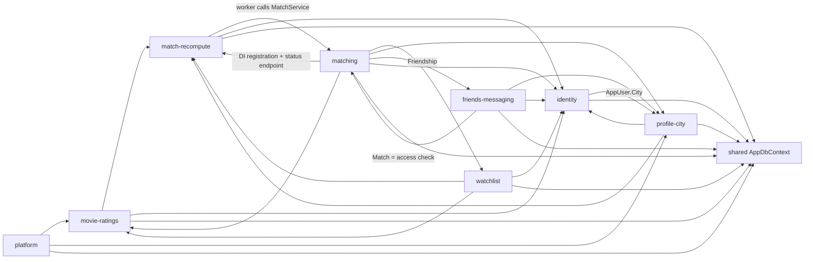

# Evidence: structure

HEAD 7756f44. Tracked files only; tests (`tests/`, `*.spec.ts`, `ClientApp/e2e`) and EF migrations excluded from the graphs. Attribution through `context/map/.work/attribute.mjs` + `capabilities.tsv`; **0 unmapped files** in both graphs. Raw output in `context/map/.work/structure/`.

## Graph sources

| Language | Source | Level | Confidence | Scope | Blind spots |
|---|---|---|---|---|---|
| C# (`movie-date.csproj`) | `dotnet list reference` → "no Project to Project references" (single project, single namespace → no per-file import graph). Fallback: custom type-reference extractor `.work/structure/cs-edges.cjs` — edge A→B when A names a type declared in B, calls an `AddApp*`/`Map*Endpoints` extension declared in B, or touches a `DbSet` (`db.Matches`, `db.Users`) whose entity lives in B. Comments/strings stripped; member access (`x.City`) and member/parameter names after a type (`CityResponse City`) skipped. | 4 (rg-style fallback) | **low** | 55 files, 95 symbols, 135 edges (`edges-cs.csv`) | DI resolution (it sees the registered *type name*, not lifetime/instance), lambda property access (`u.MatchesRequestedAt`), constants read inside interpolated strings (dropped with strings — e.g. `{WatchedMovie.MinRating}`, `{Message.BodyMaxLength}` in endpoints), EF navigation/`Include` paths, reflection, Identity framework internals. A first naive word-match pass (`structure/edges-cs-v1-wordmatch.csv`, 148 edges) produced 13 false edges from property names colliding with entity names; removed. |
| TypeScript (`ClientApp`) | TypeScript compiler API from `ClientApp/node_modules/typescript` (project toolchain), `.work/structure/ts-edges.cjs`: static imports, re-exports, dynamic `import()`; relative specifiers resolved to files. | 2 | **medium** | 24 files, 57 edges (`edges-ts.csv`): 53 runtime, 4 `type` | Angular DI (`inject(Service)` is only visible as the import), template-only references (`<app-loading>` selector usage is covered only because the component is imported into `imports: []`), HTTP coupling to the backend (URL strings). 4 imports of interfaces only (`Movie`, `City`) are compiler-elided and re-labelled `type` manually. No tsconfig path aliases found. |

The two graphs are **not connected**: SPA → API coupling goes through HTTP route strings, which no static graph here resolves (`unknown`).

## Capability graph

C# graph with the composition-root edges removed (`Program.cs` → 12 files and `AppDbContext` → 8 entity files; see Mechanical signals). Source: `structure/metrics-cs-cap-core.md` (`evidence`).

| Capability | Ca | Ce | Instability | Note |
|---|--:|--:|--:|---|
| shared (`AppDbContext`) | 8 | 0 | 0.00 | every feature reaches the single DbContext |
| identity (`AppUser`) | 6 | 2 | 0.25 | `AppUser` file-level Ca 13 — the most depended-on entity |
| match-recompute | 5 | 3 | 0.38 | Ca inflated by `Clock` (a generic helper attributed here, see below) |
| movie-ratings | 4 | 3 | 0.43 | `WatchedMoviesService` reused by watchlist |
| profile-city | 4 | 4 | 0.50 | `City`/`CityResponse` reused by matching & friends |
| matching | 2 | 7 | 0.78 | widest outgoing reach of any capability |
| watchlist | 1 | 4 | 0.80 | 9 file edges into movie-ratings |
| friends-messaging | 1 | 5 | 0.83 | |
| platform | 0 | 3 | 1.00 | `MigrationRunner` → seeders, `HealthEndpoints` → DbContext |

TS (SPA, without `main.ts`/`app.ts`/`app.config.ts`/`app.routes.ts`): shared Ca 5 (`api-errors.ts` file Ca 12, `loading.component.ts` Ca 6), profile-city Ca 3 (`profile.service.ts`: `cityLabel`, `City`), identity Ca 1 / Ce 0, matching Ce 3 / Ca 0, watchlist Ce 2 / Ca 0 (`structure/metrics-ts-cap-core.md`).

(Hand-condensed from `structure/cs-cap-core.mmd`; `Clock`-only edges into match-recompute omitted — mechanical.)

## Blast radius per capability

Incoming = who depends on it at runtime; file edges from `structure/cs-cross-cap-edges.txt` (`evidence`).

| Capability (crit.) | Incoming (runtime) | Outgoing | Contracts/types others use |
|---|---|---|---|
| identity (high) | 6 caps: every feature endpoint takes `UserManager<AppUser>`; Profile/Friends/Conversation/Match services and `MatchRecomputeTrigger` read/write `db.Users` | profile-city (`AppUser.City`), shared | `AppUser` entity (Ca 13). SPA: `auth.service.ts` Ca 6 (guard, interceptor, home, login, register, app) |
| movie-ratings (high) | watchlist (9 edges: `WatchedMoviesService`, `WatchedMovie`, `UpdateRatingRequest`, `MovieResponse`, `Movie`), matching (`WatchedMovie`, `MovieResponse`), platform (`MovieCatalogSeeder`), profile-city (`LikePattern`) | match-recompute (trigger), identity, shared | `MovieResponse` (Ca 7), `Movie` (Ca 7). SPA: `movies.service.ts` Ca 4 (watchlist, matches), `movie-search.component` reused by watchlist |
| matching (high) | match-recompute (`MatchRecomputeWorker` → `MatchService`), friends-messaging (`Match` table as access rule in `FriendsService`, `ConversationService`) | movie-ratings, watchlist, profile-city, friends-messaging (`Friendship`), identity, match-recompute, shared — Ce 7, the widest | `Match` entity. `MatchScoringService` has **Ce 0** (pure leaf) |
| match-recompute (high) | movie-ratings, watchlist, profile-city endpoints call `MatchRecomputeTrigger.RequestAsync` (7 call sites: WatchedMovies ×3, Watchlist ×3, Profile ×1); matching endpoint registers queue/trigger/worker in DI and reads queue status | matching (`MatchService`), identity (`MatchesRequestedAt` stamp), shared | `MatchRecomputeTrigger` (Ca 4) |
| friends-messaging (high) | matching (`MatchService` reads `Friendship`) | matching (`Match`), profile-city (`CityResponse`), identity, shared | `Friendship` |
| platform (high) | none (entry) | movie-ratings + profile-city seeders, shared | — |
| profile-city (medium) | identity, matching, friends-messaging, platform; SPA: friends, home, matches | identity, match-recompute, movie-ratings (`LikePattern`), shared | `CityResponse` (Ca 7), `City` (Ca 6) |
| watchlist (medium) | matching (`WatchlistItem`) | movie-ratings (heavy), match-recompute, identity, shared | — |

`inference`: a change to `AppUser`, `AppDbContext`, `MovieResponse`/`CityResponse` or `WatchedMoviesService` reaches 4–8 capabilities; a change in matching's inputs (ratings, watchlist, city, friendships) reaches matching through **data**, not calls — the static graph shows it only as matching → entity edges.

## Cycles

- File level: **0 runtime cycles** in C# and in TS (`evidence`, `metrics-cs-file.md`, `metrics-ts-file.md`).
- Capability level (C#, composition root removed): one 7-capability SCC. Smallest real loops (`evidence`):
  1. **matching ↔ match-recompute** — `MatchRecomputeWorker` → `MatchService`; back edge is `MatchesEndpoints` registering `MatchRecomputeQueue`/`Trigger`/`Worker` (`AddAppMatches`) and reading queue status. The back edge is wiring, not logic (`inference`).
  2. **matching ↔ friends-messaging** — `MatchService` reads `Friendships`; `FriendsService`/`ConversationService` query `db.Matches` as the "may befriend / may message" rule. A genuine two-way data dependency (`inference`: changing match-list semantics changes messaging access control).
  3. **identity ↔ profile-city** — `AppUser.City` vs `ProfileService`/`ProfileEndpoints` → `AppUser`. Profile lives on the identity entity (`inference`).
  4. Longer runtime loop: movie-ratings/watchlist/profile-city → match-recompute → matching → (reads) movie-ratings/watchlist/profile-city entities — the intended write→recompute→read pipeline, not an accident.
- TS: profile-city ↔ shared is a folder artifact (`home.component` in shared imports `profile.service`; `profile.component` imports `shared/api-errors`) — mechanical.

## Broken boundaries

Intended layering (`inference` from CLAUDE.md): `Contracts`/`Data` entities → `Services` → `Endpoints` → `Program.cs`; endpoints never return entities.

| Check | Result | Label |
|---|---|---|
| Endpoints returning entities | 0 found: every `Results.Ok/Json` returns a `*Response`, a service result, or an anonymous health object; `MoviesEndpoints`/`CitiesEndpoints` project with `.Select(... new MovieResponse/CityResponse)`; no service method returns `Task<entity>` | evidence (rg) |
| Endpoints skipping the Services layer (endpoint → `AppDbContext` directly) | 4: `MoviesEndpoints`, `CitiesEndpoints` (query + projection inline), `AuthEndpoints` (Identity store wiring), `HealthEndpoints` | evidence; mild deviation from the module rule |
| Recompute triggered from endpoints, not services | all 7 `trigger.RequestAsync` call sites are in Endpoints; services that write ratings/watchlist do not know about recompute → a new write path added in a service will silently skip recompute | evidence (call sites) / inference (risk) |
| Cross-feature service call | `WatchlistService` → `WatchedMoviesService` (constructor-injected; atomic mark-as-watched), `ConversationService` → `FriendsService`, `MatchRecomputeWorker` → `MatchService` | evidence |
| Feature registration placed in another feature's file | match-recompute's DI registration lives in `MatchesEndpoints.AddAppMatches` | evidence |
| Endpoints reading entity constants | `WatchedMovie.MinRating/MaxRating` (WatchedMovies, Watchlist endpoints), `Message.BodyMaxLength` (Conversations) used in validation messages — entity as source of validation rules | evidence (rg); not in edge list (inside interpolated strings) |
| SPA cross-feature imports | matches → friends.service (runtime: `FriendsService`), watchlist → movies (`MovieSearchComponent`, rating constants), friends/matches/home → profile (`cityLabel`); interface-only imports flagged `type` | evidence |

## Test risks

| Capability | Isolation difficulty | Likely test layer | Evidence |
|---|---|---|---|
| matching | `MatchService` Ce 12 (DbContext, 5 entities, 3 contracts, scoring, Clock) — needs a real DB; `MatchScoringService` Ce 0 is pure and already unit-tested (`MatchScoringTests` calls static `Proximity`, `Taste`) | unit for scoring; integration for ranking/append-only | evidence |
| match-recompute | hosted `BackgroundService` + singleton in-memory debounce queue + `TimeProvider`; tests already use a `ManualTime : TimeProvider`. `Clock.Now()` is a **static** `DateTimeOffset.UtcNow` used by 6 files, not injectable | integration (Testcontainers) with manual time; static clock limits time control in services | evidence |
| friends-messaging | access rule depends on matching's `Matches` rows → tests must seed a match list first | integration | evidence (edges) / inference |
| movie-ratings, watchlist | services directly on `AppDbContext`; watchlist pulls `WatchedMoviesService` | integration | evidence |
| identity | ASP.NET Identity + `UserManager<AppUser>` injected into every feature endpoint | integration through `WebApplicationFactory` (package present) | evidence |
| SPA features | services are thin `HttpClient` wrappers; 6 of 11 specs use `HttpTestingController`/`provideHttpClientTesting` | unit with HTTP testing controller; e2e for cross-page flows | evidence |

No mocking library referenced in test files (`rg Mock|Substitute|Moq` → none): the C# suite is integration-first against a throwaway Postgres (`evidence`).

## Centres and thin entry points

- **Load-bearing centres** (high Ca, low instability): `Data/AppDbContext.cs` (Ca 15, I 0.35), `Data/AppUser.cs` (Ca 13, I 0.07), `Contracts/MovieResponse.cs` / `Contracts/CityResponse.cs` / `Data/Movie.cs` (Ca 7, I 0), SPA `shared/api-errors.ts` (Ca 12, I 0), `auth/auth.service.ts` (Ca 6, I 0). `evidence`.
- **Hub of logic**: `Services/MatchService.cs` (Ce 12, I 0.86) — highest outgoing reach of any file; it reads five other capabilities' data.
- **Thin entry points**: `Program.cs` (Ce 12, Ca 0) only calls `AddApp*`/`Map*Endpoints` — composition root, config-as-code (false-signal 2). `app.routes.ts` (Ce 10) — route table. Endpoint files are moderately thick: they carry validation, outcome→status mapping and the recompute trigger (`inference` from edges + call sites).

## Mechanical signals

| Signal | Count | Reason |
|---|--:|---|
| `Program.cs` → endpoints/data extensions | 12 edges | composition root, config-as-code (rule 2) — removed from the core graph; it alone turns the capability SCC from 7 to 9 nodes |
| `AppDbContext` → entity files | 8 edges | EF model registration, lockstep with migrations + snapshot (rule 3) — removed from core graph |
| `Services/Clock.cs` attributed to match-recompute | 6 incoming (5 cross-capability: friends ×2, matching, movie-ratings, watchlist) | generic time helper introduced by a watchlist impl-review fix commit; inflates match-recompute Ca from ~3 to 5 — attribution artifact |
| TS `type`-only imports (`Movie`, `City` interfaces) | 4 edges | compile-time only (rule 9) |
| TS profile-city ↔ shared cycle | 2 edges | folder attribution (`home`, `shared/*` in the shared catch-all) |
| `app.routes.ts` lazy `import()` of 6 feature components | 10 edges | route table (rule 2) |
| Discarded word-match edges | 13 | property names equal to entity names (`City`, `Movie`, `Message`) — extractor artifact, fixed |

## Unknowns

- **Runtime coupling not in the graph** (`unknown`): the recompute path is an in-process singleton queue + hosted worker (`AddSingleton<MatchRecomputeQueue>`, `AddHostedService<MatchRecomputeWorker>`); whether pending work survives a restart or a second Fly machine depends on the `MatchesRequestedAt` stamp handling — not resolvable statically. DI lifetimes beyond those three were not enumerated.
- **SPA ↔ API** coupling is via URL strings; no graph links Angular services to endpoints (`unknown`). External API consumers: none known (`unknown (external)`).
- **Data-level coupling**: matching reads other capabilities' tables; schema changes to `WatchedMovies`, `WatchlistItems`, `Cities`, `Friendships` affect matching without any call edge. EF `Include`/navigation chains not captured.
- C# graph is a heuristic (level 4, low confidence): missed edges inside lambdas/property chains and interpolated strings; possible residual false edges from name collisions.
- Tools worth installing (not installed, not run): **dependency-cruiser** or **madge** for the SPA (rule config + cycle detection in CI); for C#, **NDepend** (commercial) or a Roslyn-based analyzer (e.g. an ArchUnitNET test) to get a real type-level graph and enforce the Endpoints→Services→Data rule.

## Commands run

- `dotnet list movie-date.csproj reference`; `git ls-files '*.cs'`, `git ls-files 'ClientApp/src/*.ts'`; tool presence check (`ClientApp/node_modules/.bin`, `which ast-grep`)
- `node .work/structure/ts-edges.cjs` (TypeScript compiler API) → `edges-ts.csv`; `node .work/structure/cs-edges.cjs` → `edges-cs.csv` (+ v1 word-match kept for diff)
- `node .claude/skills/10x-repo-map/scripts/graph-metrics.mjs` on both edge lists: `--modules capabilities.tsv --kind runtime` (full and core), file level, `--emit mermaid`
- `node .work/attribute.mjs` for file→capability; awk join → `structure/cs-cross-cap-edges.txt`, `cs-cap-pairs.txt`
- `grep` confirmations: DbSets, `AddApp*`/`Map*` registrations, `Results.Ok/Json` returns, `trigger.RequestAsync` call sites, cross-feature TS imports, test packages / mocks / `TimeProvider`
