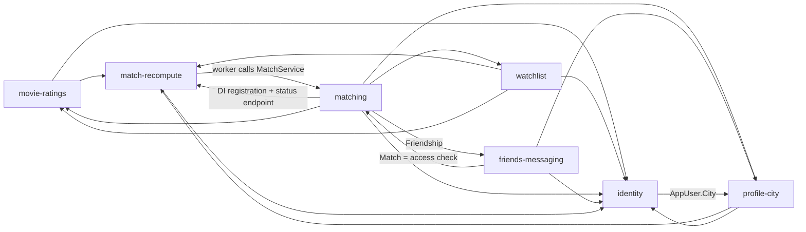

# Repo map — MovieDate

## TL;DR

MovieDate is a small dating MVP (ASP.NET Core minimal API + Angular SPA + Postgres on Fly.io) that matches people by movie taste. Users sign in, rate the movies they've watched, keep a want-to-watch list and set a Polish home city. A background recompute then turns those inputs into an append-only ranked match list. Users can add a match as a friend and message them. The whole history is 3 days and 77 commits from one human, almost all of them agent-assisted, and each capability was built as exactly one roadmap slice. So "buzz" here mostly means review findings, planning attention and structural reach, not churn. There are no reverts, issues or incidents. The pressure points are **movie-ratings** (most review findings, and other slices had to fix its shared search code) and **matching** (the widest-reaching logic in the codebase, never reviewed, and its test-plan phase is still open). **match-recompute**, **friends-messaging** and **identity** are on watch.

*Capability graph from `evidence/3-structure.md` (C# type references, composition root removed). The edges into `shared` (AppDbContext) and the platform → seeder edges are omitted here; all are in the evidence file.*

## Terrain

Buzz is rated relative to the other capabilities: H / M / L, `?` = no evidence (unknown, not low). Families: **chg** change, **fix** fix pressure, **fri** friction (agent review findings and second attempts; there is no human review in this repo), **att** planning attention, **rch** runtime reach.

| Capability | What it does | Criticality | chg | fix | fri | att | rch | Trend | Where it lives |
|---|---|---|---|---|---|---|---|---|---|
| **movie-ratings** | Search the seeded movie catalog; add, edit or remove watched movies with a rating | high (core input, user data) | H (62) | M (1 own + 2 spillover) | H (3W/7O, most of any) | M | H (watchlist 9 edges, `MovieResponse`/`Movie` Ca 7, `LikePattern` used by profile-city) | fading (built 11-02, spillover 11-03) | `Endpoints/MoviesEndpoints.cs`, `Endpoints/WatchedMoviesEndpoints.cs`, `Services/WatchedMoviesService.cs`, `ClientApp/src/app/movies` |
| **matching** | Score candidates (shared ratings, shared watchlist, distance decay); append-only ranked list with cold-start fallback | high (core value) | M (47) | ? (never reviewed) | ? (never reviewed) | H (412-line plan; test-plan Phase 3 R3 open) | H (`MatchService` Ce 12, reads 5 capabilities; two-way with friends) | new 11-03 | `Services/MatchService.cs`, `Services/MatchScoringService.cs`, `Endpoints/MatchesEndpoints.cs`, `ClientApp/src/app/matches` |
| match-recompute | Background queue and worker that recomputes a user's matches after every rating, watchlist or city write | high (freshness of core value) | L (19; 7 code) | ? (never reviewed) | ? | M (test-plan R1, now covered by e2e; separate worker parked) | H (7 trigger call sites in 3 capabilities' endpoints) | new 11-03 | `Services/MatchRecompute{Queue,Trigger,Worker}.cs` |
| friends-messaging | One-sided add-a-match-as-friend, then stored message history | high (user-to-user access control) | M (49) | ? (no fix round) | M (2W/7O, 2 pending) | H (only slice with research.md; biggest plan and PR) | M (Ca 1, but access rule depends on matching) | new 11-03 | `Services/FriendsService.cs`, `Services/ConversationService.cs`, `ClientApp/src/app/friends` |
| identity | Email + password accounts (ASP.NET Identity), session, guard, display name | high (access gates everything) | M (43) | L (1 own) | M (impl 3W/5O + plan-review) | M | H (`AppUser` Ca 13 across 6 capabilities) | fading (built 11-02) | `Endpoints/AuthEndpoints.cs`, `Data/AppUser.cs`, `ClientApp/src/app/auth` |
| watchlist | Want-to-watch list with atomic mark-as-watched | medium (user data, matching input) | M (41) | M (1 own + 1 spillover) | M (2W/6O, race-condition themes) | M | L (Ca 1) | new 11-03 | `Endpoints/WatchlistEndpoints.cs`, `Services/WatchlistService.cs`, `ClientApp/src/app/watchlist` |
| profile-city | Pick home city from the Polish catalog; profile API; home nudge | medium (user data, proximity input) | M (52) | L (1 own) | M (1W/6O) | M | M (`CityResponse` Ca 7, `City` Ca 6) | new 11-03 | `Endpoints/ProfileEndpoints.cs`, `Endpoints/CitiesEndpoints.cs`, `Services/ProfileService.cs`, `ClientApp/src/app/profile` |

- **Platform & infrastructure** (high: deploy and migrations can take production down). Fly.io + Docker, `Data/MigrationRunner.cs` (`--migrate` release command), `/health`, CI quality gates, agent impl-review on PRs, and the Playwright critical-path e2e. Volume is high but steady (74 changes, 39 of them prose), and it comes from course lessons. All 16 CI, deploy and review runs are green.
- **Shared foundations** (medium). `Program.cs` (composition root), `Data/AppDbContext.cs` (Ca 15), the EF model snapshot, the SPA shell (`app.routes.ts`, `app.html`, `home`, `shared/api-errors.ts` Ca 12) and the test fixtures. These are touched by every slice by design.
- **Docs & planning** (low). `context/foundation/*` (PRD, roadmap, test plan, lessons), plus one archive folder per slice holding its plan and impl-review. This is where every decision is recorded.
- **Coverage:** 0% unmapped. Of the code changes (non-`.md`, 360), 58% are in business capabilities, 32% in shared and 10% in platform. The catch-alls together are 42%, just above the 40% guide, and are genuine wiring hubs (`Program.cs`, DbContext, routes). The product has only 7 business capabilities (S-07 and S-08 shipped as one change). Noise excluded: 198 changes (vendored `.claude/` course tooling, the lock file, seed JSON).

**Folder ≠ capability:** each capability spans `Endpoints/` + `Services/` + `Data/` + `Contracts/` + `ClientApp/src/app/<feature>` + `tests/`. In the other direction, a few files serve capabilities they don't belong to:
- `Endpoints/LikePattern.cs` and `movie-search.component` sit in movie-ratings but serve profile-city and watchlist.
- match-recompute's DI registration lives in `MatchesEndpoints.AddAppMatches`.
- `Services/Clock.cs` is attributed to match-recompute but is a generic helper (introduced by a watchlist review fix).
- `Data/AppUser.cs` carries fields for identity, profile-city (city), matching (display name) and match-recompute (stamps).

## Real couplings

| Coupling | How we know | Mechanical? |
|---|---|---|
| movie-ratings / watchlist / profile-city writes → **match-recompute** (`trigger.RequestAsync` at 7 call sites, all in Endpoints, none in Services) | runtime graph + call-site grep (3-structure). Co-change support is only 1 because it was wired in one dropped mass-touch commit, 3edc850 (1-history) | no. A write path added inside a service would silently skip recompute (inference) |
| match-recompute → matching (`MatchRecomputeWorker` → `MatchService`); back edge = DI registration + status endpoint | runtime graph | back edge is wiring only |
| **matching ↔ friends-messaging**: `FriendsService`/`ConversationService` use `db.Matches` as the "may befriend / may message" rule; `MatchService` reads `Friendships` | runtime graph + co-change (3 commits, conf 0.60) | no. Changing match-list semantics changes messaging access control |
| matching → movie-ratings, watchlist, profile-city **through data** (reads their tables) | graph shows only entity edges. Data-level coupling is otherwise `unknown` | no |
| watchlist → movie-ratings (`WatchlistService` → `WatchedMoviesService`, atomic mark-watched; shared movie-search UI) | runtime graph (9 edges) + co-change (3, conf 0.50) | no |
| profile-city → movie-ratings (`LikePattern`, search path) | runtime graph + fix spillover (set-home-city's review fix edited 7 movie-ratings files) | no |
| identity ↔ profile-city (`AppUser.City`) and `AppUser` as a field sink for 4 capabilities | runtime graph + history (`AppUser.cs` edited by 3 slices) | no |
| Backend `Contracts/*` ↔ hand-written TS services in `ClientApp/src/app/<feature>/*.service.ts` | no tool covers it (HTTP URL strings, no generated client) | `unknown`. Drift would not show in co-change |
| `Program.cs`, `AppDbContext.cs`, model snapshot, `app.routes.ts` fan-in | co-change hubs | **mechanical** (config-as-code, EF lockstep; compile-guarded) |

No file-level runtime cycles in either language. The one capability-level loop (7 capabilities) is the intended write → recompute → read pipeline plus the matching ↔ friends access rule.

## Risk zones

### 1. movie-ratings: catalog search and watched-movie writes
**Why:** this is the input every match depends on, and its search code is reused by other capabilities that have already had to fix it.
- **Friction (H):** the most agent-review findings of any slice (3W/7O). Themes: a deleted-but-cookied user causes a 500, the SPA list drifts after a 404/409, query logic sits in endpoints (2-discussion).
- **Reach (H):** watchlist depends on it with 9 file edges, including `WatchedMoviesService`; `MovieResponse` and `Movie` each have Ca 7; profile-city uses `LikePattern` (3-structure).
- **Change / fix (H/M):** the most changes (62). Two of its three fix commits are spillover from other slices' review rounds, including a 7-file fix of the search path by set-home-city (1-history). This spillover is the independent part of the signal: other capabilities had to repair code that lives here.
- *Independence:* friction (review findings), reach (static graph) and spillover (other slices' fixes) have different causes. Raw volume alone would be slice size, and is not counted on its own.
- **Files:** `Endpoints/MoviesEndpoints.cs` (skips the Services layer), `Endpoints/WatchedMoviesEndpoints.cs`, `Endpoints/LikePattern.cs`, `Services/WatchedMoviesService.cs`, `ClientApp/src/app/movies/movie-search.component.ts`, `ClientApp/src/app/movies/movies.service.ts`.

### 2. matching: scoring, ranked list, and the rule other features rely on
**Why:** this is the product's core value and the widest-reaching logic in the repo. It was never reviewed, and its test-plan phase hasn't started.
- **Reach (H):** `MatchService` has Ce 12, the highest of any file, and reads data from 5 capabilities. friends-messaging uses the `Matches` table as its access-control rule (3-structure).
- **Attention (H):** a 412-line plan, and test-plan Phase 3 "Privacy and ranking contract" (R2 privacy leaks, R3 ranking correctness) is **not started** (2-discussion).
- **Contradiction, stated as a question:** fix pressure and friction are `?`. The ranked-match-list slice has no `reviews/` folder (no plan-review, no impl-review, no fix round), while every lower-criticality slice got one. Is matching clean, or just unexamined?
- *Independence:* attention (plan and open test-plan risks) and reach (graph) have different causes. `MatchScoringService` (Ce 0, unit-tested) is the safe part; the risk is in `MatchService` and in the data it reads.
- **Files:** `Services/MatchService.cs`, `Services/MatchScoringService.cs`, `Endpoints/MatchesEndpoints.cs`, `Data/Match.cs`, `tests/MovieDate.Tests/MatchesTests.cs`.

### Watch (narrowly below the bar)
- **match-recompute.** High criticality and high reach (7 trigger call sites across 3 capabilities' endpoints), but low change, and like matching it was never reviewed. The queue is an in-process singleton, so it's `unknown` whether pending work survives a restart or a second Fly machine. The static `Clock.Now()` limits time control in tests. Files: `Services/MatchRecomputeTrigger.cs`, `Services/MatchRecomputeWorker.cs`, `Services/MatchRecomputeQueue.cs`.
- **friends-messaging.** It has the most planning attention, but that's because it was the last and largest slice (shared cause with change, counted once). Its access control depends on matching's semantics, test-plan R2 (privacy) is open, and 2 CI review findings are still `PENDING`. Files: `Services/FriendsService.cs`, `Services/ConversationService.cs`.
- **identity.** `Data/AppUser.cs` is the most depended-on entity (Ca 13, 6 capabilities) and accretes fields from downstream slices. Friction is medium: session cached with no 401 handling, plus the lesson "key per-user data on user id, not email". Files: `Data/AppUser.cs`, `Endpoints/AuthEndpoints.cs`, `ClientApp/src/app/auth/auth.service.ts`.

### Looks hot, is not
- `Program.cs` (11 changes), `Data/AppDbContext.cs`, `app.routes.ts` and `app.html` are composition-root and route-table fan-in that every slice must touch. They are compile-guarded.
- `Data/Migrations/AppDbContextModelSnapshot.cs` and the `*.Designer.cs` files are EF regeneration lockstep.
- Platform's change and attention volume both come from course lessons (CI gates, e2e, deploy plan); 39 of its 74 changes are prose. It has one fix round and all 16 runs are green.
- The "fix share" signal (movie-ratings 21%, watchlist 18%): all 5 fix commits are scheduled `impl-review fixes` rounds, a workflow stage rather than production incidents, with spillover reattributed.
- Concentration: one human carries 100% of everything. That's the baseline, not a bus-factor finding.
- match-recompute's high incoming count is partly `Clock.cs`, a generic helper attributed to it.

## Whom to ask

Team-size baseline: **one human maintainer**, plus an AI agent co-author on 81% of human commits. Every capability has the same single owner, and there is no CODEOWNERS file. In practice, the "person" to ask is the slice's written record:

| Zone | Ask | Where the reasoning is written down |
|---|---|---|
| movie-ratings | the sole maintainer | `context/archive/2026-11-02-rate-watched-movies/` (plan + impl-review F1–F10); set-home-city's review (search fix) |
| matching | the sole maintainer | `context/archive/2026-11-03-ranked-match-list/plan.md` (no review exists); PRD § Business Logic; `test-plan.md` R2/R3 |
| match-recompute (watch) | the sole maintainer | `context/archive/2026-11-03-async-match-recompute/plan.md`; `tech-stack.md` (recompute decision) |
| friends-messaging (watch) | the sole maintainer | `context/archive/2026-11-03-first-message-to-friend/` (research, plan, 2 reviews); PR #2 |
| identity (watch) | the sole maintainer | `context/archive/2026-11-02-register-and-login/` (plan-review + impl-review); `lessons.md` |

## First day

1. `context/foundation/prd.md`: FR-001..007 and **Business Logic** (scoring, distance decay, append-only list) are the spec that every capability implements.
2. `Program.cs`: the composition root. Every capability is an `AddApp*` / `Map*Endpoints` pair, so this is the table of contents.
3. `Data/AppUser.cs` and `Data/AppDbContext.cs`: the shared entity and the single DbContext every feature reaches.
4. `Endpoints/WatchedMoviesEndpoints.cs` → `Services/WatchedMoviesService.cs`: a typical write path, including the recompute trigger call.
5. `Services/MatchRecomputeTrigger.cs` → `Services/MatchRecomputeWorker.cs`: how writes become recomputes (in-process queue, hosted worker).
6. `Services/MatchService.cs` + `Services/MatchScoringService.cs`: where the core value lives (orchestration plus a pure scoring leaf).
7. `Services/FriendsService.cs`: how the match list becomes an access-control rule for friendship and messaging.
8. `ClientApp/src/app/app.routes.ts`: the SPA's route table into the feature folders. Then `ClientApp/e2e/critical-path.spec.ts` for the end-to-end user flow.

## Limitations

- **Window:** the entire history is 3 days (2026-11-01..03), built slice by slice by one person with an AI agent. Trend just mirrors roadmap build order. "Seasonal" and "rework after delivery" cannot be observed yet. Buckets are calendar days (a deviation from ISO weeks).
- **Sources:** git plus gh (3 PRs, 0 issues, 16 runs). 70 of 77 commits went straight to main, so pre-PR discussion exists only in `context/` planning files. There is no human review to measure.
- **Graph coverage:** C# uses a heuristic type-reference extractor (low confidence). It misses lambdas and property chains, constants in interpolated strings, EF navigation/`Include`, and DI lifetimes. TypeScript uses the compiler API (medium). SPA↔API coupling via URL strings is not covered. Data-level coupling (matching reading other capabilities' tables) is only partly visible. Worth adding: dependency-cruiser or madge for the SPA, and an ArchUnitNET/Roslyn rule test (or NDepend) for C#, which would also enforce Endpoints → Services → Data.
- **Capability coverage:** 0% unmapped. Catch-alls hold 42% of code changes (genuine wiring hubs). Attribution quirk: `Contracts/MatchStatusResponse.cs` falls to matching rather than match-recompute (the `Contracts/*Match*` glob wins), which affects one file.
- **Agents:** all four evidence agents completed; none failed or were partial.
- **What this map does NOT say:** anything about production behaviour. There is no error tracker (observability is parked in the roadmap) and Fly logs were not inspected, so production failures are `unknown`, not "none". Nor does it say anything about code quality inside matching and match-recompute, which were never reviewed.
- **Unknowns worth a focused investigation:**
  1. Does the in-memory recompute queue lose work on restart or when Fly runs multiple machines (`MatchesRequestedAt` stamp handling)?
  2. Are all rating, watchlist and city write paths guaranteed to trigger recompute, given that triggers live in endpoints rather than services?
  3. Do matching's semantics (append-only, fallback candidates) leak access in friends-messaging (test-plan R2)?
  4. Do backend `Contracts/*` and the hand-written TS service types drift?
  5. Is the impl-review step's absence for matching and match-recompute hiding defects? A review pass there is the cheapest next signal.
  6. Pending CI review items for friends-messaging (F1–F2), and stale `PENDING` markers in the testing-ci-quality-gates review.
